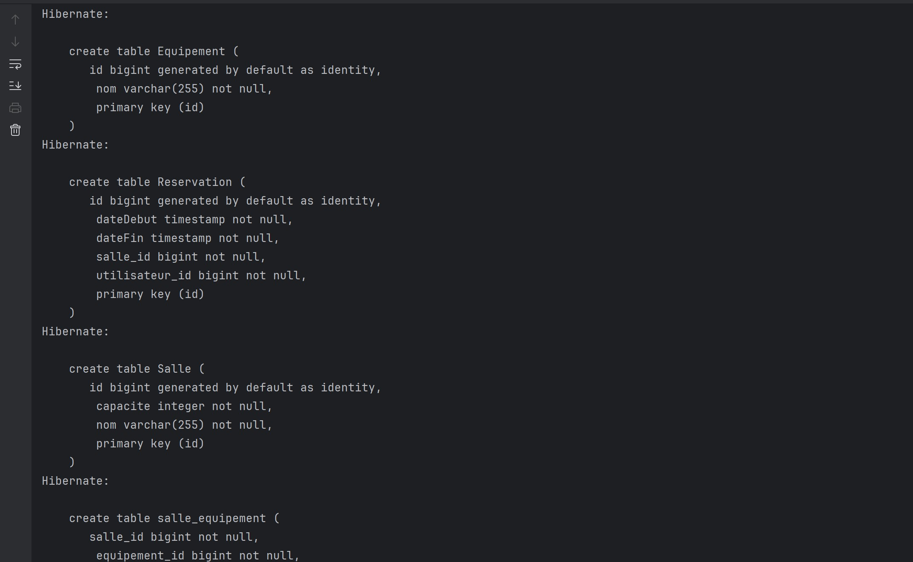
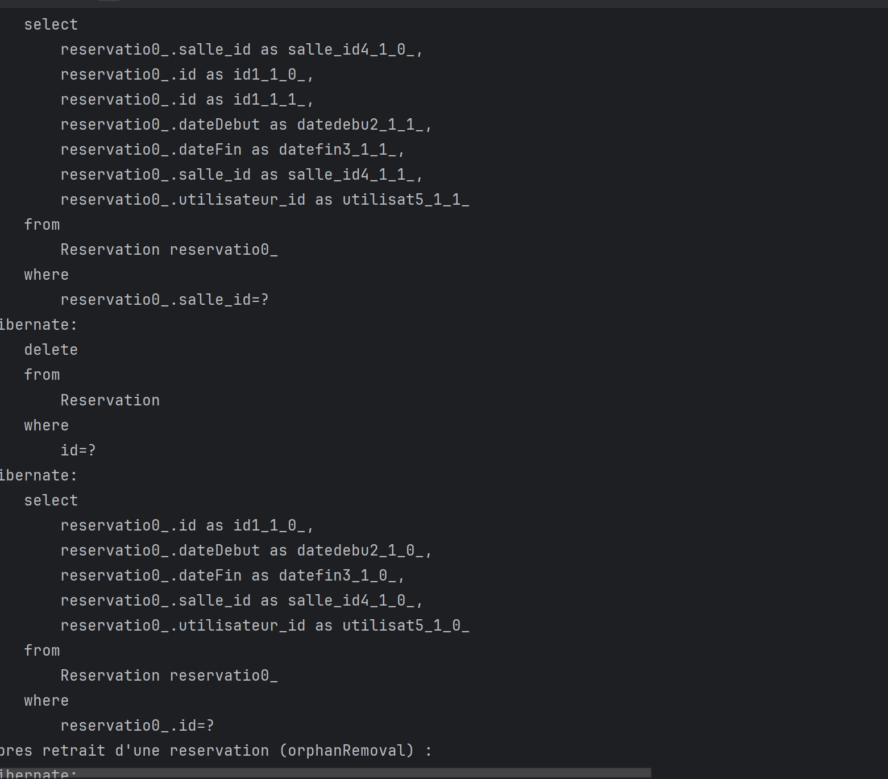
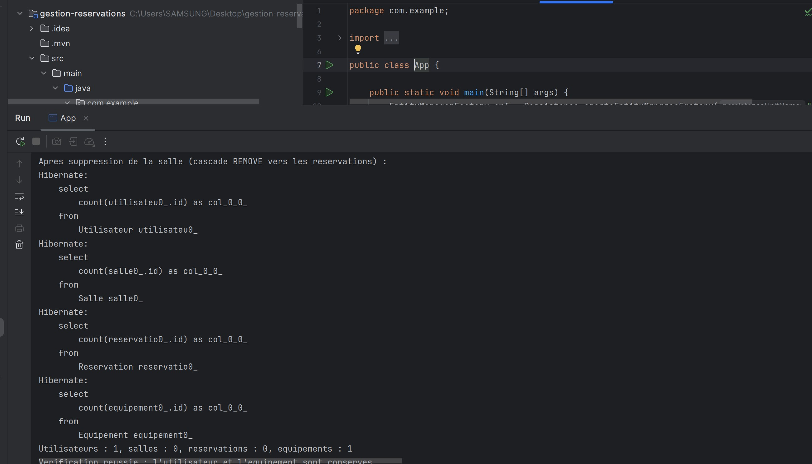



Hibernate crée les tables des entités et la table de jointure entre les salles et les équipements.

Hibernate supprime la réservation retirée de la collection grâce à `orphanRemoval`, puis vérifie qu’elle n’existe plus.

Dans cette capture, la salle et ses réservations sont supprimées, tandis que l’utilisateur et l’équipement sont conservés.
